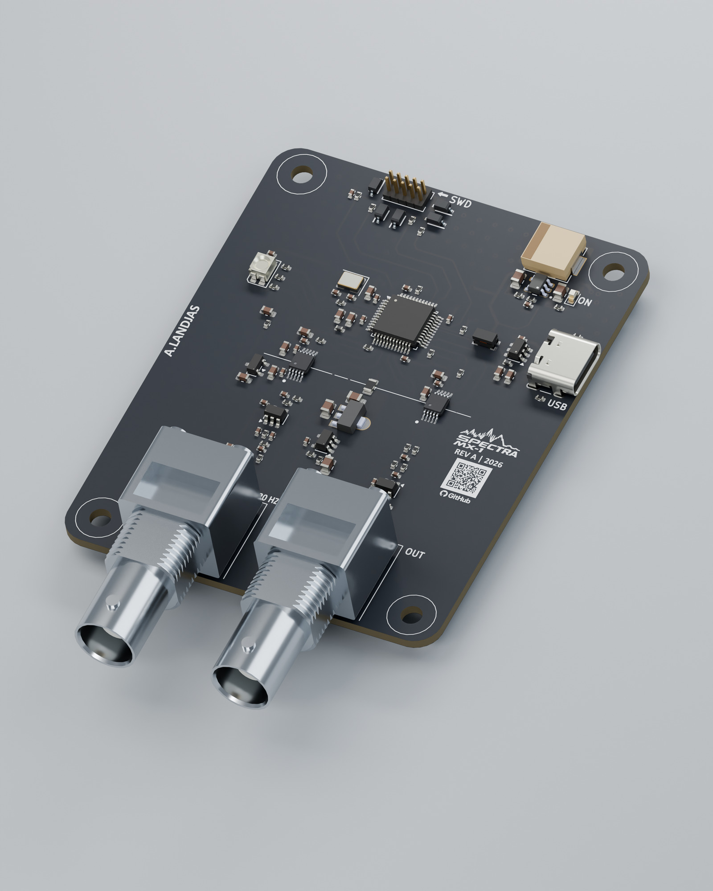
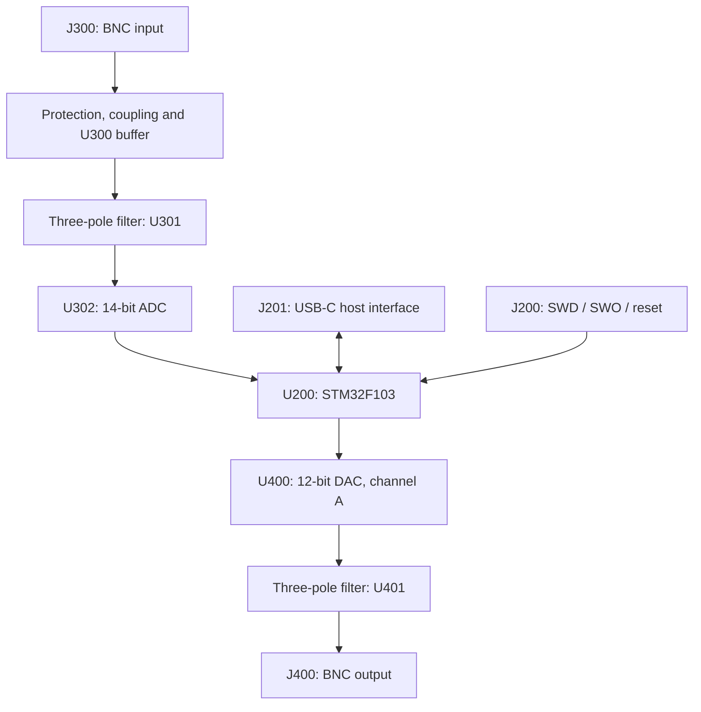
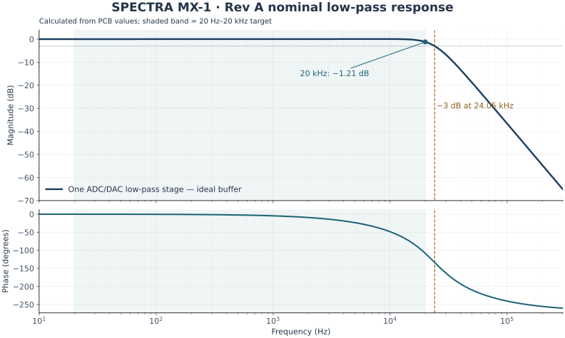
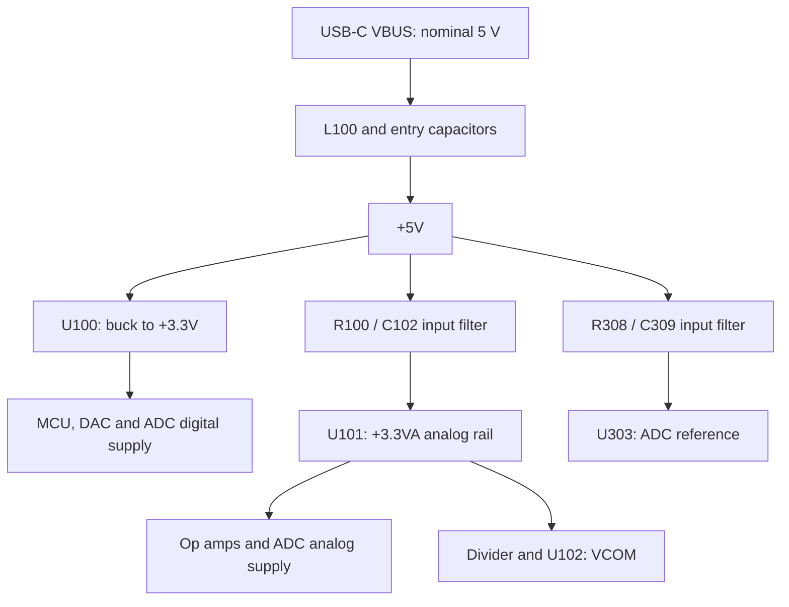
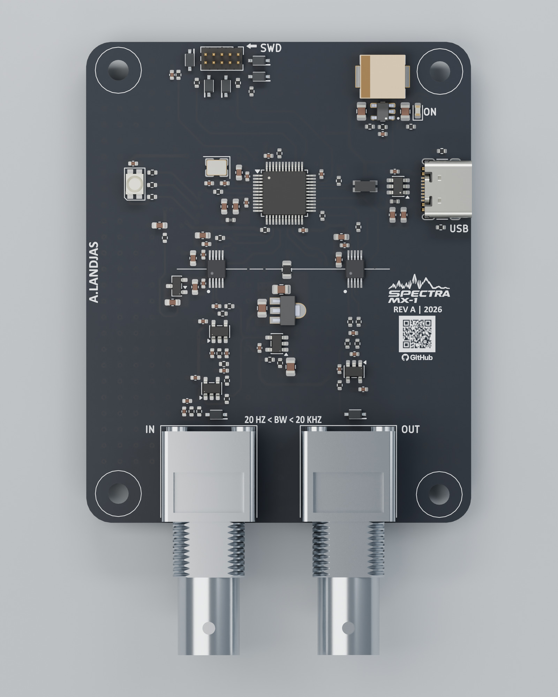
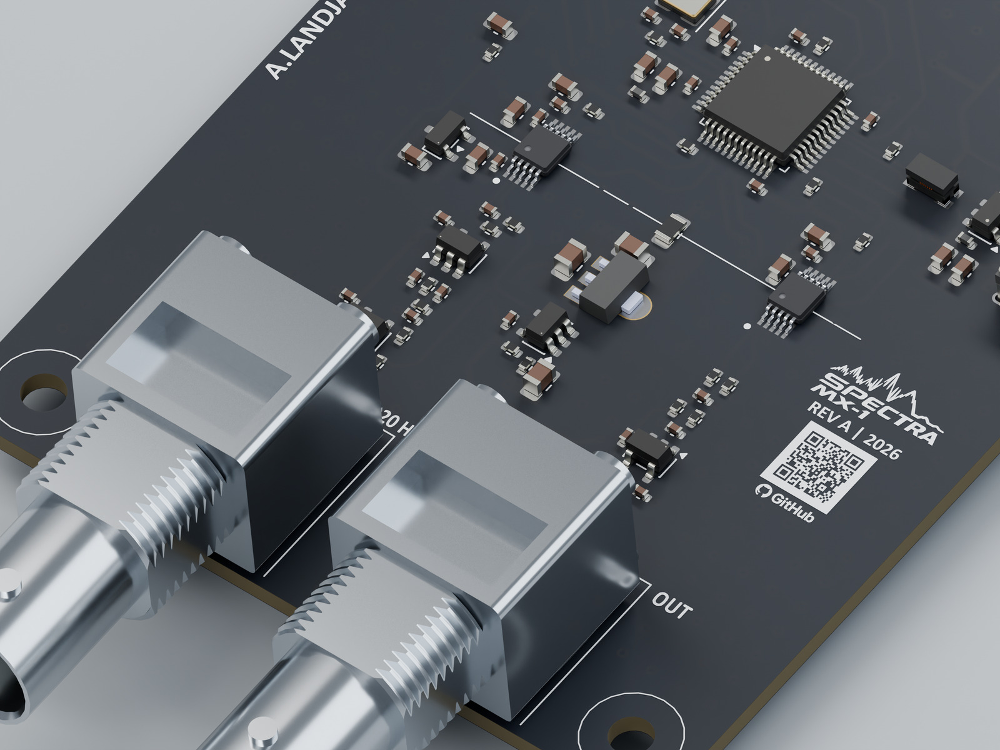
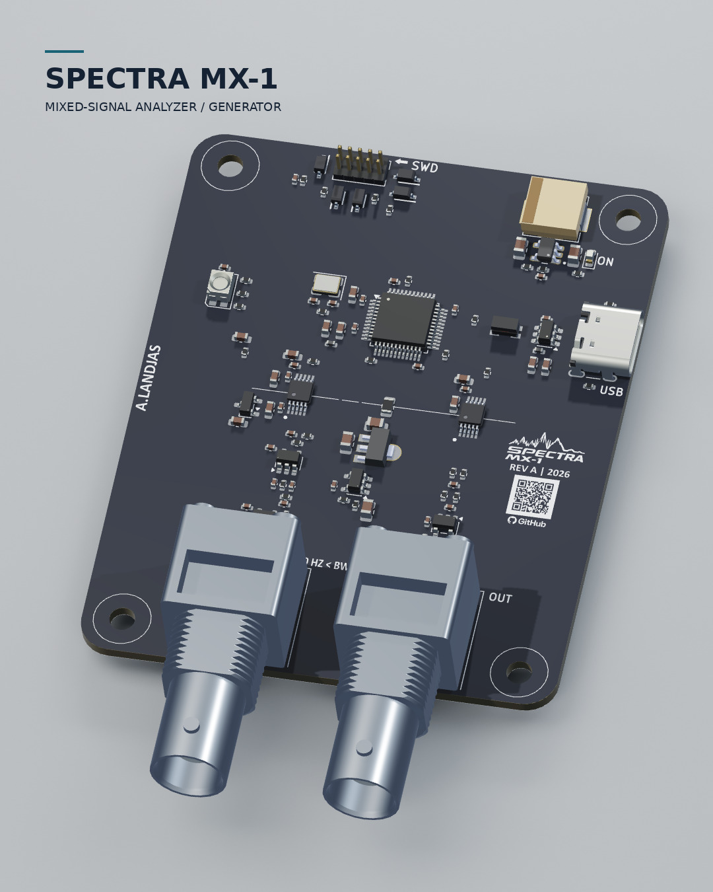

# SPECTRA MX-1

*STM32-controlled mixed-signal acquisition and generation board*

SPECTRA MX-1 is a four-layer PCB designed in KiCad for low-frequency analog acquisition and signal generation, with a target operating band of **20 Hz–20 kHz**. An STM32F103 controls an external differential-input ADC and a dual-channel DAC through separate SPI interfaces. The board combines input conditioning, active filtering, reference generation, USB-C connectivity and BNC analog connectors.

**Revision:** A · **Author:** [Akram Landjas](https://github.com/landjas09) ·

<p align="center">
  
</p>

*Studio visualization of the Rev A assembly.*

## Contents

- [Project status](#project-status)
- [Hardware specification](#hardware-specification)
- [System architecture](#system-architecture)
- [Analog acquisition path](#analog-acquisition-path)
- [Analog generation path](#analog-generation-path)
- [Nominal filter analysis](#nominal-filter-analysis)
- [Power architecture](#power-architecture)
- [MCU, clocks and pin assignments](#mcu-clocks-and-pin-assignments)
- [External interfaces](#external-interfaces)
- [PCB stackup and mechanics](#pcb-stackup-and-mechanics)
- [BOM and component selection](#bom-and-component-selection)
- [Repository files and opening the project](#repository-files-and-opening-the-project)
- [Firmware scope](#firmware-scope)
- [Bring-up and validation](#bring-up-and-validation)
- [Pre-release engineering review](#pre-release-engineering-review)
- [3D models, renders and animation](#3d-models-renders-and-animation)
- [Development roadmap](#development-roadmap)
- [Contributing and technical feedback](#contributing-and-technical-feedback)
- [References](#references)
- [Acknowledgments and licensing](#acknowledgments-and-licensing)

## Project status

This documentation describes the supplied **Rev A PCB snapshot**, saved by KiCad 10.0. Connections, values, component references and stackup data were extracted from MixedSignal_Analyzer_Generator.kicad_pcb. Device characteristics are identified separately from calculated circuit estimates and board measurements.

| Item | Current status |
| --- | --- |
| PCB layout and embedded footprints | Available in the supplied PCB snapshot |
| Board/component 3D export | Available as SPECTRA_MX1.glb |
| Studio renders and animation | Available |
| Main project file, root schematic and child sheets | included in the repository |
| Custom library sources and library tables | Required for a complete editable project release |
| BOM / purchasing data | Draft; imported metadata and generic components require review |
| Firmware and host software | Not included in the reviewed handoff |
| ERC, DRC and fabrication-release reports | Results not supplied |
| Fabrication, assembly and electrical validation | Pending |
| Measured bandwidth, noise, distortion, ENOB and throughput | Pending |

The 20 Hz–20 kHz band is a **design target**. Converter bit depths are device specifications. The filter plots below are **analytical estimates using the current component values**. A validated input range, output load rating and sustained streaming rate have not yet been established.

## Hardware specification

| Parameter | Rev A implementation / interpretation |
| --- | --- |
| MCU | U200: STM32F103CBTx; manufacturer-part field identifies STM32F103CBT6 |
| MCU resources | Arm Cortex-M3; 128 KB Flash, 20 KB SRAM; device supports a CPU clock up to 72 MHz |
| External clock | Y200: 16 MHz crystal; C208/C209: 10 pF; R201: 0 Ω series link |
| External ADC | U302: ADC141S626CIMM/NOPB; 14-bit SAR, differential input, external reference |
| ADC bus | SPI1; chip select, clock and data-out routed; MCU MOSI not used for this ADC |
| ADC device conversion-rate range | Manufacturer specifies 50–250 kSPS; timing/performance conditions must be checked for the board's nominal 3.3 V supplies |
| ADC voltage reference | U303: REF3033; nominal 3.3 V |
| DAC | U400: DAC7563SDGSR; two 12-bit buffered voltage-output channels |
| DAC bus / controls | SPI2; independent active-low SYNC, LDAC and CLR control |
| Externally routed DAC output | Channel A through the reconstruction filter to J400 |
| DAC channel B | Connected to R402, a 10 kΩ load to GND; no second analog-output connector |
| Op amps | Four MCP6001U devices: U102, U300, U301 and U401 |
| Analog input | J300: single-ended BNC; AC-coupled conditioning and biased converter drive |
| Analog output | J400: BNC; DC-coupled filtered voltage output with 49.9 Ω series resistor |
| Host interface | J201: USB-C receptacle carrying USB 2.0 D+/D− and 5 V VBUS; MCU supports USB full speed |
| Debug | J200: 2 × 5, 1.27 mm header carrying SWD, SWO, reset, GND and 3.3 V reference |
| Primary supply | USB-C VBUS, nominal 5 V |
| Power domains | +5V, +3.3V, +3.3VA, MCU VDDA, buffered VCOM and ADC reference |
| PCB | Four copper layers; current internal zones connect both In1.Cu and In2.Cu to GND |
| Board outline | Approximately 60 × 75 mm, excluding protruding connector bodies |
| Mounting | Four 3.2 mm non-plated M3 mounting holes |
| Modeled finish / thickness | ENIG; approximately 1.57 mm copper/dielectric stack, approximately 1.60 mm including modeled solder mask |
| Design tool | PCB file identifies KiCad 10.0 |

Device limits and specifications above do not establish equivalent board-level performance. See the [manufacturer references](#references) and [validation plan](#bring-up-and-validation).

## System architecture



The input and output processing chains are physically grouped near the BNC connectors. The digital-control and USB circuitry occupy the upper part of the PCB. Separate SPI peripherals allow acquisition and generation to be scheduled independently.

**Rev A bias generation is fixed:** VCOM is produced by a resistor divider and an op-amp buffer. DAC channel B is not connected to the bias generator in this snapshot.

## Analog acquisition path

### Input connector and protection

J300's center contact connects to /ADC/IN; its shield contacts connect to GND. D300, labeled CDSOD323-T03C, is placed between the input net and GND.

R300 = 1 kΩ and C300 = 150 pF form the first input RF-filtering network. R301 = 2.2 MΩ provides a return path from /ADC/IN_RF to GND.

Ignoring the following coupling/bias network and source impedance, the simple R300/C300 pole is approximately **1.06 MHz**. Its role is upstream high-frequency filtering; the following active filter sets the useful low-frequency response.

### AC coupling, bias and first buffer

C301 = 100 nF connects /ADC/IN_RF to /ADC/IN_BUFF. R302 = 2.2 MΩ biases /ADC/IN_BUFF to VCOM. U300 is an MCP6001U configured as a unity-gain buffer.

For a low-impedance source, the dominant coupling estimate is:

$$
f_{\mathrm{HP}} \approx \frac{1}{2\pi R_{302}C_{301}} \approx 0.72\ \mathrm{Hz}.
$$

This estimate depends on the source and the other return paths. **20 Hz is the lower edge of the stated target band, not the calculated −3 dB frequency of C301/R302.** The high-value bias resistance also makes leakage, contamination and startup settling relevant during assembly and validation.

### Active anti-alias filter

The signal at /ADC/IN_BUFF_OUT passes through a three-pole unity-gain RC/active network using U301. The topology combines the initial RC section with a buffered Sallen–Key section.

| Function | Components |
| --- | --- |
| First series resistor / shunt capacitor | R303 = 6.8 kΩ; C303 = 1 nF |
| Following series resistors | R304 = 22 kΩ; R305 = 12 kΩ |
| Feedback capacitor to the buffer output | C305 = 1 nF |
| Final input shunt capacitor | C304 = 150 pF |
| Unity-gain buffer | U301, MCP6001U |

The resulting nominal response is discussed in [Nominal filter analysis](#nominal-filter-analysis). Actual response depends on op-amp behavior, component tolerances and loading.

### Converter input network

U301 drives /ADC/ADC_IN+ through R306 = 1 kΩ. The ADC negative input is biased from VCOM through R307 = 1 kΩ. C307 = 150 pF connects the two ADC input nets.

This produces a nominal differential RC pole around **531 kHz** when approximated using R306 + R307. The actual SAR sampling network adds switched-capacitor loading, so acquisition settling must also be checked.

The external BNC signal is single-ended. The ADC measures the conditioned positive input relative to the biased negative input.

### ADC reference and supplies

- U302 VA, pin 10, connects to +3.3VA.
- U302 VIO, pin 9, connects to +3.3V.
- U303 REF3033 receives +5V through R308 = 49.9 Ω.
- C309 = 10 µF filters /ADC/ADC_VREF_VIN.
- U303's output connects to /ADC/ADC_Vref and U302 pin 1.
- C310 = 10 µF and C311 = 100 nF decouple the ADC reference.

The ideal R308/C309 supply-filter pole is approximately **319 Hz**. It is an input-supply filter for the reference, not a series filter between the reference output and ADC pin.

### Code interpretation and input range

The ADC's serial result is a **14-bit signed two's-complement value**. After extracting and sign-extending the conversion bits correctly, its ideal differential-voltage relationship is:

$$
V_{\mathrm{IN+}}-V_{\mathrm{IN-}}
\approx D_{\mathrm{signed}}\frac{2V_{\mathrm{REF}}}{2^{14}}.
$$

At nominal VREF = 3.3 V, the ideal differential code step is approximately **0.403 mV**.

The selected reference and input topology require engineering review. TI's full-range single-ended guidance uses VREF no greater than VA/2. Rev A selects a nominal 3.3 V reference while driving the ADC from a nominal 3.3 V analog supply and holding the negative input near 1.65 V. Reference tolerance, valid common-mode range, available signal swing and code utilization must therefore be resolved before publishing an external-input amplitude rating.

## Analog generation path

### DAC and digital control

U400 is a DAC7563 dual-channel, 12-bit voltage-output DAC. SPI2 carries commands to its DIN pin, with separate GPIO control for SYNC, LDAC and CLR.

The DAC accepts a **24-bit serial command frame**. Firmware must follow the command/address/data arrangement and timing in the DAC7563 datasheet; the register width is distinct from its 12-bit conversion resolution.

In Rev A:

- Channel A, /DAC/DAC_OUT_A, drives the output-filter chain.
- Channel B, /DAC/DAC_OUT_B, is connected to R402 = 10 kΩ to GND.
- AVDD connects to +3.3V.
- C400 = 10 µF and C401 = 100 nF decouple the supply.
- C402 = 1 µF connects the reference pin to GND.

### Reference and gain configuration

The internal 2.5 V reference is available by command and is disabled at power-up. Enabling it selects a gain configuration that must be handled explicitly.

For this nominal 3.3 V supply, **gain = 1 with the internal 2.5 V reference is the proposed initial configuration**. A 5 V full-scale request from gain = 2 exceeds the supply headroom. This is a firmware requirement to validate, not an implemented configuration reported by this repository.

For gain = 1:

$$
V_{\mathrm{DAC,A}} \approx 2.5\ \mathrm{V}\frac{D}{4096},
\qquad 0\le D\le4095.
$$

The ideal code step is approximately 0.610 mV. Codes 0, 2048 and 4095 nominally request 0 V, 1.25 V and 2.4994 V before output errors and loading. These are calculation values for bring-up, not measured output specifications.

### Reconstruction filter and BNC output

| Function | Components |
| --- | --- |
| First series resistor / shunt capacitor | R401 = 6.8 kΩ; C403 = 1 nF |
| Following series resistors | R403 = 22 kΩ; R404 = 12 kΩ |
| Feedback capacitor to the buffer output | C406 = 1 nF |
| Final input shunt capacitor | C404 = 150 pF |
| Unity-gain output buffer | U401, MCP6001U |
| BNC series resistor | R405 = 49.9 Ω |
| Output protection device | D400, CDSOD323-T03C |

The filter values match the ADC anti-alias network. U401's output drives J400 through R405. There is **no series output AC-coupling capacitor** in the reviewed path, so the output carries its DC level as well as the generated waveform.

R405 contributes approximately 50 Ω of series resistance. A 50 Ω BNC connector designation does not establish a validated 50 Ω load-drive capability. Initial characterization should use a high-impedance measurement input; output-current capability, loaded swing and cable-capacitance stability remain to be measured.

## Nominal filter analysis

Both active low-pass stages use the same resistor/capacitor values. A small-signal model with an ideal unity-gain buffer gives:

$$
H_{\mathrm{LP}}(s)=
\frac{1}{
1+(12.92\times10^{-6})s+
(8.652\times10^{-11})s^2+
(2.6928\times10^{-16})s^3
},
\qquad s=j2\pi f.
$$

| Frequency / metric | Ideal response of one low-pass stage |
| --- | --- |
| DC gain | 1 V/V |
| 1 kHz | Approximately +0.001 dB |
| 10 kHz | Approximately +0.050 dB |
| 20 kHz | Approximately −1.21 dB |
| −3 dB frequency | Approximately 24.05 kHz |
| 40 kHz | Approximately −13.22 dB |
| 50 kHz | Approximately −18.76 dB |
| 100 kHz | Approximately −36.57 dB |
| High-frequency asymptotic slope | −60 dB/decade |



**Model scope:** this is the common three-pole low-pass network only. It excludes finite op-amp gain/bandwidth, ADC sampling kickback, reference noise, source/load impedance, component tolerances, coupling/protection networks and PCB parasitics. End-to-end DAC-to-ADC loopback passes through both low-pass stages.

The [analysis script](docs/analysis/nominal_filter.py) and [numerical results](docs/analysis/nominal_filter_results.json) accompany this README.

To regenerate the analytical figure and results:

```bash
python -m pip install numpy scipy matplotlib
python docs/analysis/nominal_filter.py
```

For a 20 kHz signal band, the sample rate must exceed 40 kSPS and provide practical anti-aliasing margin. The existing filter's attenuation at the chosen Nyquist frequency must be evaluated against the required alias rejection. No ADC sample rate, DAC update rate or spectral-performance result is claimed as firmware-validated yet.

## Power architecture



### USB entry and digital rail

L100 is labeled **100 nH** in the inductor symbol. C101 = 1 µF is connected from VBUS to GND, and C100 = 1 µF is connected from +5V to GND.

U100 TLV62569DBVR generates the digital rail. Its enable and input pins connect to +5V. L101 is labeled MWSA0603S-150MT; imported component metadata identifies 15 µH. C104 and C105 are 22 µF input/output capacitors.

With R101 = 100 kΩ, R102 = 22 kΩ and the regulator's nominal 0.6 V feedback reference:

$$
V_{\mathrm{OUT,ideal}}\approx0.6(1+100/22)\approx3.327\ \mathrm{V}.
$$

The rail is named +3.3V. Its assembled regulation, ripple, startup and load response must be measured. C106 is a feed-forward capacitor footprint labeled DNP.

The regulator's component rating does not establish a 2 A USB-powered board rating. Available current depends on the USB source, entry network, inductor, thermal behavior and the final power budget.

### Analog supply

R100 = 10 Ω and C102 = 22 µF filter the +5V supply before U101, labeled HT7533-1. U101's output is +3.3VA, with C103 = 22 µF on that rail.

The ideal input RC pole is approximately **723 Hz**. R100 also creates a load-dependent DC drop, so LDO dropout and analog current must be checked together.

The imported U101 manufacturer field identifies UMW. Confirm the exact supplier part, current rating, pinout and stability requirements when completing the BOM rather than assuming every similarly named regulator has identical specifications.

### VCOM generation

R105 = 1 kΩ to +3.3VA and R104 = 1 kΩ to GND form a nominal half-supply divider. C107 = 22 µF filters the divider node, /Power/VREF. U102 MCP6001U buffers it as VCOM.

VCOM is nominally **1.65 V** when +3.3VA is 3.3 V. The divider's 500 Ω Thevenin resistance and C107 give an ideal pole near **14.5 Hz**. The buffer supplies the bias node without asking the divider to drive the ADC input network directly.

### MCU analog supply

L201 = 10 nH connects +3.3V to the MCU's VDDA net. C205 = 10 nF and C206 = 1 µF decouple VDDA; U200 VSSA connects to GND.

**VDDA and +3.3VA are distinct nets:** VDDA supplies the MCU's analog domain, while +3.3VA supplies the external analog circuitry and ADC VA.

| Net | Source / nominal value | Main loads |
| --- | --- | --- |
| VBUS | USB-C, nominal 5 V | Entry filter and USB protection reference |
| +5V | VBUS after L100 | Buck, analog-supply filter and ADC-reference supply filter |
| +3.3V | U100 buck, nominal 3.3 V | MCU VDD/VBAT, DAC AVDD, ADC VIO, LED and debug reference |
| +3.3VA | U101 linear regulator, nominal 3.3 V | U102/U300/U301/U401 and ADC VA |
| VDDA | +3.3V through L201 | MCU analog supply |
| VCOM | Divider followed by U102, nominal 1.65 V | Input bias and ADC negative-input network |
| /ADC/ADC_Vref | U303, nominal 3.3 V | External ADC reference |
| /DAC/DAC_VREF | U400 reference pin with C402 | DAC reference node; internal reference needs firmware configuration |

## MCU, clocks and pin assignments

### MCU and clock source

U200 is an STM32F103CBT6 in LQFP48. Its VDD and VBAT pins connect to +3.3V; its VSS and VSSA pins connect to GND.

Y200 is labeled 16 MHz. C208 and C209 are 10 pF crystal-load capacitors. R201 is a 0 Ω series link between HSE_OUT and the crystal-side /Mcu/XTAL_IN net. The exact crystal orderable part and load-capacitance requirement remain BOM decisions.

A **proposed** clock configuration for firmware bring-up is HSE = 16 MHz, HSE divided by two into the PLL, PLL ×9 for 72 MHz, and the appropriate USB divider for 48 MHz. This configuration is not present as validated firmware in the supplied files. Firmware must account for APB limits and the timer/peripheral clock tree.

### Interface pin map

These assignments come from the actual U200 pad nets. Package pins refer to the reviewed LQFP48 footprint.

| Function | MCU port | Package pin | PCB net / connection |
| --- | --- | ---: | --- |
| ADC chip select | PA4 | 14 | /SPI1_NSS → U302 NCS |
| ADC serial clock | PA5 | 15 | /SPI1_SCK → R309, 0 Ω → ADC SCLK |
| ADC serial data | PA6 | 16 | /SPI1_MISO ← U302 DOUT |
| DAC frame select | PB12 | 25 | /SPI2_NSS → U400 NSYNC |
| DAC serial clock | PB13 | 26 | /SPI2_SCK → R400, 0 Ω → DAC SCLK |
| DAC serial data | PB15 | 28 | /SPI2_MOSI → U400 DIN |
| DAC clear | PB2 | 20 | /DAC_NCLR → U400 NCLR |
| DAC update latch | PB10 | 21 | /DAC_NLDAC → U400 NLDAC |
| USB D− | PA11 | 32 | /Mcu/USB_D- |
| USB D+ | PA12 | 33 | /Mcu/USB_D+ |
| SWD data | PA13 | 34 | /Mcu/SWDIO → R210 → J200 |
| SWD clock | PA14 | 37 | /Mcu/SWCLK → R211 → J200 |
| Trace output | PB3 | 39 | /Mcu/SWO → R212 → J200 |
| Reset | NRST | 7 | /Mcu/NRST → R213 → J200 |
| Crystal input | PD0 | 5 | /Mcu/HSE_IN |
| Crystal output | PD1 | 6 | /Mcu/HSE_OUT → R201 → crystal |
| Boot selection | BOOT0 | 44 | /Mcu/BOOT; R200 = 10 kΩ to GND |
| RGB red cathode drive | PB8 | 45 | /Mcu/TIM4-CH1 → R207 → red |
| RGB green cathode drive | PB6 | 42 | /Mcu/TIM4-CH2 → R208 → green |
| RGB blue cathode drive | PB7 | 43 | /Mcu/TIM4-CH3 → R209 → blue |

PA7/SPI1 MOSI and PB14/SPI2 MISO are unconnected in this layout. PB2 also has the STM32 boot-selection role associated with BOOT1; boot-mode changes must account for its DAC-clear connection.

### Indicator mapping

D100 is the green digital-power indicator, with R103 = 1 kΩ to GND.

D206 is a common-anode RGB LED powered from +3.3V. R207/R208/R209 are 1 kΩ series resistors; the MCU sinks LED current.

| LED color | Physical MCU pin | Default TIM4 channel | Current PCB net label |
| --- | --- | --- | --- |
| Red | PB8 | TIM4_CH3 | /Mcu/TIM4-CH1 |
| Green | PB6 | TIM4_CH1 | /Mcu/TIM4-CH2 |
| Blue | PB7 | TIM4_CH2 | /Mcu/TIM4-CH3 |

The existing TIM4 net labels differ from the default STM32 alternate-function mapping. Firmware configuration should follow the **physical pins and the STM32 pin-multiplexing table**. Net-label cleanup belongs in the pre-release review.

## External interfaces

### USB-C — J201

J201 is a 16-contact USB 2.0 Type-C receptacle using the GCT USB4105 footprint family.

| Connection | Rev A implementation |
| --- | --- |
| VBUS contacts | Joined to VBUS; nominal 5 V bus power |
| GND contacts | Joined to GND |
| D+ / D− contacts on both orientations | Joined by signal and routed to the USB protection/filter chain |
| CC1 | R206 = 5.1 kΩ to GND |
| CC2 | R205 = 5.1 kΩ to GND |
| SBU1/SBU2 | Unconnected |
| Shield pads | Marked unconnected in the reviewed PCB |

The data path is J201 → U201 USBLC6-2SC6 protection → L200 CMF3216F-900-2P-T common-mode choke → PA11/PA12. R204 = 1.5 kΩ connects USB D+ to +3.3V for the full-speed pull-up.

The CC pull-downs implement the board's sink-side connection. No USB Power Delivery controller is present. Higher-voltage PD modes are outside this hardware configuration.

USB descriptors, device class, enumeration and data-transfer performance depend on firmware that has not yet been supplied. Shield/chassis termination also requires an explicit final decision.

### SWD / trace / reset — J200

J200 is an **unshrouded 2 × 5 pin header at 1.27 mm pitch**. Identify pin 1 from the footprint pad/silkscreen before attaching a cable.

| Pin | Signal | Board connection |
| ---: | --- | --- |
| 1 | Target voltage reference | +3.3V |
| 2 | SWDIO | PA13 through R210 = 49.9 Ω |
| 3 | GND | GND |
| 4 | SWCLK | PA14 through R211 = 49.9 Ω |
| 5 | GND | GND |
| 6 | SWO | PB3 through R212 = 49.9 Ω |
| 7 | Unconnected | No electrical connection; the header has no blocking key |
| 8 | Unconnected | No TDI connection |
| 9 | GND | GND |
| 10 | NRST | MCU reset through R213 = 49.9 Ω |

Pin 1 presents the target's logic-voltage reference; external target powering through this pin is not established as a supported power method. D200/D201/D203/D204 protect the connector-side SWDIO, SWCLK, SWO and reset nets; D205 is connected between +3.3V and GND.

The connector-side SWO net is spelled /Mcu/SW0_CONN in the source. It connects to the MCU's SWO signal despite the zero in that label.

### BNC connectors — J300 and J400

Both connectors use the Amphenol B6252HB-NPP3G-50 horizontal BNC footprint family. Confirm the exact connector order code, mechanical dimensions and mating clearance when finalizing the BOM.

| Connector | Center contact | Shield | Function |
| --- | --- | --- | --- |
| J300, IN | /ADC/IN | GND | Single-ended, AC-coupled analog input |
| J400, OUT | /DAC/OUT | GND | Filtered, DC-coupled DAC channel-A output |

The two ports share the board's common ground. Output load capability and external-input amplitude limits remain validation items.

## PCB stackup and mechanics

### Current copper/reference arrangement

The source contains routed segments on F.Cu and B.Cu, with a GND zone assigned to **both internal layers**.

| Layer | Copper thickness | Current use |
| --- | ---: | --- |
| L1 — F.Cu | 35 µm | Components, signal routing and local power/GND pours |
| L2 — In1.Cu | 17.5 µm | GND zone |
| L3 — In2.Cu | 17.5 µm | GND zone |
| L4 — B.Cu | 35 µm | Signal routing |

The exported reference arrangement is therefore **signal / ground / ground / signal**. Layer classifications in KiCad do not override the actual zone-net assignments.

| Dielectric interval | File type | Modeled thickness | Material parameters |
| --- | --- | ---: | --- |
| F.Cu → In1.Cu | Core | 0.100 mm | FR4; εr = 4.5, loss tangent = 0.02 |
| In1.Cu → In2.Cu | Core | 1.265 mm | FR4; εr = 4.5, loss tangent = 0.02 |
| In2.Cu → B.Cu | Prepreg | 0.100 mm | FR4; εr = 4.5, loss tangent = 0.02 |

The modeled bare copper/dielectric stack sums to **1.570 mm**. The two 12.7 µm solder-mask layers bring the model to approximately **1.595 mm**. Final laminate construction, tolerances and impedance must be agreed with the fabricator.

### Layout snapshot

- Board outline: approximately 60 × 75 mm with rounded corners.
- Four non-plated 3.2 mm mounting holes, M01–M04.
- 116 total footprint records: 110 electrical component positions, four mounting holes and two artwork footprints.
- 662 track segments: 580 on F.Cu and 82 on B.Cu.
- 383 vias in the snapshot, including 346 assigned to GND.
- Stored track widths include 0.229, 0.29337, 0.300 and 0.500 mm.
- ENIG is the finish recorded in the board stackup.
- Smallest ordinary passive footprints are 0402 imperial / 1005 metric.

These counts describe the file and do not certify routing completeness, return-path quality or DRC clearance. Verify filled copper around vias, connector pads and transitions; stored width values alone do not establish controlled impedance.

<p align="center">
  
</p>

### Placement and reference strategy

The layout groups the sensitive input, reference and conversion networks near U302 and keeps the generation filter near J400. U100's switching circuit and the digital/USB area occupy separate regions from the main BNC signal paths.

Review priorities are the buck input/switching/output loops, decoupling loops, ADC-reference charging path, crystal loop and continuous references beneath USB/SPI routes. Ground stitching should support transitions and field containment; its effectiveness depends on placement and connectivity.

## BOM and component selection

**BOM status: draft.** Current nominal values and imported ordering metadata are documented; production purchasing fields and assembly decisions are not complete.

The [extracted board inventory](docs/board-inventory.md) lists all 110 electrical positions with footprint identifiers and available manufacturer/part fields.

| References | Source value / family | Role |
| --- | --- | --- |
| U100 | TLV62569DBVR | Digital-rail buck regulator |
| U101 | HT7533-1 | Analog-rail linear regulator; imported supplier metadata identifies UMW |
| U102 | MCP6001U | VCOM buffer |
| U200 | STM32F103CBT6 manufacturer-part field | MCU |
| U201 | USBLC6-2SC6 | USB data-line protection |
| U300 | MCP6001U | Input buffer |
| U301 | MCP6001U | Anti-alias filter buffer |
| U302 | ADC141S626CIMM/NOPB | External ADC |
| U303 | REF3033 | ADC reference |
| U400 | DAC7563SDGSR | DAC |
| U401 | MCP6001U | Output-filter buffer |
| L100 / L201 | 100 nH / 10 nH labels | Supply-filter inductors |
| L101 | MWSA0603S-150MT; imported 15 µH description | Buck output inductor |
| L200 | CMF3216F-900-2P-T | USB common-mode choke |
| D200/D201/D203/D204/D205/D300/D400 | CDSOD323-T03C | Debug, supply and analog-port protection |
| Y200 | 16 MHz | HSE crystal |
| J200 | 2 × 5, 1.27 mm header | SWD interface |
| J201 | USB-C, USB4105 footprint family | USB / power entry |
| J300/J400 | B6252HB-NPP3G-50 footprint family | BNC ports |

Before purchasing, normalize imported field names such as Manufacturer, MF, MANUFACTURER, MP and Manufacturer Part Number. Imported availability/price text is not a current procurement check.

Finalize exact orderable codes, package/pin variants, voltage/power ratings, resistor tolerances, capacitor dielectric/tolerance/DC-bias behavior, inductor saturation/DCR and crystal load requirements. Confirm MCP6001U's pin arrangement and the converters' 10-pin DGS package land patterns.

**C106 is intentionally labeled DNP in its value field.** Its source PCB attributes do not include the DNP flag. Align schematic/PCB population flags and exported BOM/position data before assembly.

## Repository files and opening the project

### Publication layout

Keep the native KiCad project, root schematic and all child sheets together. The following is the intended repository organization; entries marked pending have not been reviewed as part of this snapshot.

| File / directory | Purpose / availability |
| --- | --- |
| README.md | Project documentation |
| MixedSignal_Analyzer_Generator.kicad_pcb | Reviewed PCB layout |
| Matching .kicad_pro and root .kicad_sch | Main editable project; pending inclusion |
| All child .kicad_sch sheets | Schematic hierarchy; pending inclusion |
| Custom symbol/footprint libraries, fp-lib-table and sym-lib-table | Reproducible library dependencies; pending inclusion |
| SPECTRA_MX1.glb | Supplied complete assembly export |
| docs/media/ | README renders, calculated filter figure and animation |
| docs/analysis/ | Reproducible nominal filter model and calculation results |
| docs/board-inventory.md | Draft component inventory extracted from the PCB |
| Firmware and host-software directories | Add when implementations are available |
| Fabrication outputs and assembly data | Add after design-release review |
| Validation reports | Add measured results and conditions when available |
| LICENSE and third-party notices | Declare project reuse terms and preserve external asset licenses |

The README package provides this document and its docs directory. Copy **README.md and docs/** together into the repository root so the relative media and analysis links resolve. The native hardware/project files remain separate release inputs.

### Opening the design

1. Use KiCad 10.0 or a compatible newer version for this PCB file.
2. For the complete project, open the main .kicad_pro file after it and the complete schematic hierarchy are published.
3. For the reviewed layout snapshot, open MixedSignal_Analyzer_Generator.kicad_pcb directly in PCB Editor.
4. Install/relink custom libraries using project-relative paths and the supplied library tables.
5. Refill copper zones, check the stackup and run the release checks against the same source revision.

The PCB embeds its placed footprints, so the layout can be inspected without every original library. Editing symbols, updating footprints or synchronizing from a schematic requires the complete library/project sources.

Custom identifiers present in the snapshot include Footprints:SOIC-10-adc141s626, Footprints:TLV-SOT95P280X145-5N, Footprints:STM-LQFP-48_7x7mm_P0.5mm, Footprints:LDO-SOT89, Footprints:CMC-1206 and Footprints:INDM7066X300N. The converter footprint's name should not substitute for checking the actual VSSOP/MSOP package dimensions.

## Firmware scope

Firmware is a **planned implementation** in the reviewed handoff. No build command, binary, USB protocol or runtime result is supplied here.

| Area | Implementation requirements |
| --- | --- |
| Clock initialization | Match the 16 MHz HSE, CPU/APB limits and required USB clock |
| ADC capture | Control conversion framing, acquisition time, SPI timing and signed-data extraction |
| DAC generation | Configure reference/gain, form serial commands and control update/clear sequencing |
| Timing | Establish a repeatable capture/update cadence; evaluate DMA/buffering and jitter |
| USB transport | Define descriptors, device class, framing, sample metadata and error reporting |
| Indicators | Use the physical RGB pin mapping and common-anode polarity |
| Calibration | Record measured offset, gain and reference values with test conditions |
| Recovery | Establish reset, clear, startup-output and disconnect behavior |

For 14-bit samples stored in 16-bit words, the raw payload estimate is **2 × sample rate bytes/second**, before protocol overhead. Buffer capacity and sustained USB throughput must be established by measurement.

Any future host API should document sample/update rates, voltage scaling, packet format, waveform conventions and firmware compatibility. Spectral analysis, waveform playback and automated transfer-function measurements are intended software use cases, not currently implemented features claimed by this README.

## Bring-up and validation

### Suggested sequence

1. **Assembly inspection:** confirm polarity, exact pin variants, soldering, DNP decisions and connector orientation; inspect for shorts before applying power.
2. **Power-only checks:** use a nominal 5 V source with a current limit chosen from the finalized load budget; measure +3.3V, +3.3VA, VDDA, VCOM and the ADC reference.
3. **MCU/debug:** connect a voltage-compatible SWD probe, read the MCU identity and verify reset, BOOT0 and HSE operation.
4. **DAC DC checks:** explicitly configure its reference/gain, then test zero, midpoint and near-full-scale codes with a high-impedance meter/scope.
5. **ADC checks:** verify conversion framing, signed data and bias/reference behavior before increasing signal amplitude.
6. **Frequency/load checks:** sweep both analog chains, measure distortion/noise and establish safe input and output operating ranges.
7. **USB integration:** test enumeration, sustained transfer, buffering and disconnect recovery.
8. **Loopback:** connect the DAC output to the ADC input, use known waveforms and record the complete chain's gain, phase and spectral behavior.

Begin analog tests with a small signal, such as a 1 kHz sine, while monitoring the internal biased nodes and supply rails. The input coupling network removes external DC; a loopback test must account for the distinct DAC output DC level and ADC bias.

### Results to publish

| Test | Conditions / quantities to record | Current result |
| --- | --- | --- |
| Power rails | Source voltage, load, DC levels, ripple and startup | Pending |
| Regulator behavior | Current budget, LC stability, dropout and thermal rise | Pending |
| VCOM / ADC reference | Absolute levels, tolerance ordering, noise and startup settling | Pending |
| Clock / debug | HSE frequency, clock tree, reset and SWD communication | Pending |
| ADC capture | Sample rate, SPI timing, code alignment and offset/gain | Pending |
| DAC output | Reference/gain setting, code-to-voltage response and startup state | Pending |
| Analog bandwidth | Source/load impedance, input level, gain and phase vs frequency | Pending |
| Noise / distortion | Bandwidth, FFT length/window, sample rate, level, SNR/THD/SINAD/ENOB method | Pending |
| Output loading | Swing, current, DC error and stability vs resistive/capacitive load | Pending |
| Input headroom | Valid bias/common-mode, clipping points and protection behavior | Pending |
| USB streaming | Payload rate, duration, packet loss and latency | Pending |
| DAC-to-ADC loopback | Both filters, calibration, clocking and source/load conditions | Pending |

Document the firmware commit, assembly revision, exact components, instrument settings and environmental conditions with each result. Keep calculated, simulated and measured curves labeled separately.

## Pre-release engineering review

The current files are a design snapshot. The following items are concrete review points from the supplied board, not a claim that ERC/DRC or hardware validation has already passed.

| Item | Review required before a fabrication/firmware release |
| --- | --- |
| Full source hierarchy | Publish and cross-check the root/child schematics, project settings and library tables against this PCB |
| ADC reference / bias | Resolve the REF3033 choice, analog-supply tolerance, valid common mode and input-range/code utilization described above |
| Buck LC network | Validate L101's imported 15 µH value and C105's 22 µF effective capacitance against TLV62569 design guidance and actual load/transient behavior |
| Analog regulator identity | Confirm U101's exact UMW order code, pinout, current limit, dropout and required output capacitance |
| DAC configuration | Explicitly establish reference/gain and a defined startup output within the available supply |
| RGB net names | Reconcile TIM4 labels with the PB6/PB7/PB8 physical pin/channel map |
| USB shield | Decide the currently unconnected shield-pad treatment and document the grounding/chassis strategy |
| C106 population | Reconcile the DNP value label with official population flags and export behavior |
| Custom package footprints | Check pad pitch, pin numbering, orientation and solder-mask rules against the final selected parts |
| Crystal selection | Match Y200's specified load and startup requirements to C208/C209 and board parasitics |
| Input/output operation | Establish verified external input limits, high-impedance/loaded output behavior and protection performance |
| Stackup / mechanics / DFM | Confirm the fabrication stack, filled references, hole locations, connector clearances and assembly capability |
| Release checks | Run ERC/DRC with documented settings; refill/review copper and inspect fabrication output files |

Resolve review items in the native design files, record the revision and update the documentation and inventory together.

### Manufacturing handoff

After the review is closed, produce matching Gerber/Excellon files, a stackup/fabrication drawing, assembly drawings, the finalized BOM and placement files. Include copper, mask, silkscreen and board-outline outputs as required by the selected fabricator.

Check plated/non-plated holes, solder-mask/paste apertures, connector pin-1 orientation, DNP fields, copper near mounting hardware and the artwork's minimum printable feature size. Fabrication and assembly files should identify the same hardware revision and source commit.

## 3D models, renders and animation



The original SPECTRA_MX1.glb supplies the board/component geometry. Studio render materials follow the navy mask, white silkscreen and metallic connectors in the reference views.

U302 and U400 had no assigned models in the source export. Matching generic 3 × 3 mm, 0.5 mm-pitch MSOP/VSSOP package visualization models were added for the rendered assembly. Their rendered presence does not replace assigning/checking the final model and land pattern in KiCad.

### Animation

<p align="center">
  <a href="docs/media/SPECTRA_MX1_Animation.mp4"></a>
</p>

[Open or download the studio animation](docs/media/SPECTRA_MX1_Animation.mp4) — 20 seconds, 1080 × 1350 pixels, 30 fps, H.264 MP4, silent.

The sequence presents a board orbit, analog-section close-up, digital-section close-up and return to the opening view. Geometry and labels come from the supplied CAD export.

### Silkscreen artwork

The board includes the SPECTRA MX-1 mark, revision text, author marking and a GitHub QR/logo footprint. The QR currently encodes [the author's GitHub profile](https://github.com/landjas09).

The QR has been decoded successfully from rendered images and the encoded animation. Print-size, silkscreen-process and manufactured-board readability remain fabrication checks. Silkscreen-only artwork has no component procurement role and should be handled consistently in BOM/placement export settings.

## Development roadmap

| Stage | Deliverables |
| --- | --- |
| Source release preparation | Complete project/schematic hierarchy, custom libraries and normalized BOM fields |
| Hardware review | Resolve the pre-release table and document ERC/DRC/DFM review results |
| Prototype fabrication | Fabricate/assemble Rev A or the corrected revision; record actual fitted components |
| Initial firmware | Validate clocking, debug, RGB mapping and ADC/DAC drivers |
| Host connection | Establish USB enumeration, sample framing and a reproducible host interface |
| Characterization | Publish rails, gain/phase, input/output limits, noise/distortion and streaming results |
| Revision planning | Update hardware and firmware from measured findings; maintain revision notes |

Potential uses include low-frequency waveform capture, DAC waveform generation, analog-circuit characterization and filter/transfer-function experiments. Expansion to substantially higher frequencies requires revisiting converters, op amps, filtering, clocking and transport as a system.

## Contributing and technical feedback

Technical feedback on the analog paths, reference/bias choices, power network, pin mapping and layout is welcome. Include the hardware revision, component references, relevant nets and operating conditions when reporting a finding.

For measured results, include the fitted components, firmware revision and instrument settings. Separate calculation/simulation results from bench data. Hardware changes should update the native KiCad sources, BOM, inventory and revision notes together; firmware changes should identify the hardware revision they support.

## References

The PCB snapshot is the source for component values, net connections, pin assignments and stackup. Manufacturer material is used for device characteristics and programming/operating requirements.

- [STMicroelectronics — STM32F103CB product information](https://www.st.com/en/microcontrollers-microprocessors/stm32f103cb.html) and [STM32F103x8/xB datasheet](https://www.st.com/resource/en/datasheet/stm32f103cb.pdf).
- [Texas Instruments — ADC141S626 product information](https://www.ti.com/product/ADC141S626) and [ADC141S626 datasheet](https://www.ti.com/lit/gpn/ADC141S626).
- [Texas Instruments — DAC7563 product information](https://www.ti.com/product/DAC7563) and [DAC7563 / DACxx6x datasheet](https://www.ti.com/lit/ds/symlink/dac7563.pdf).
- [Texas Instruments — TLV62569 datasheet](https://www.ti.com/lit/ds/symlink/tlv62569.pdf), including output-filter selection guidance.
- [Texas Instruments — REF30 family datasheet, including REF3033](https://www.ti.com/lit/gpn/REF30).
- [Microchip — MCP6001/1R/1U/2/4 datasheet](https://ww1.microchip.com/downloads/en/DeviceDoc/MCP6001-1R-1U-2-4-1-MHz-Low-Power-Op-Amp-DS20001733L.pdf).
- [STMicroelectronics — USBLC6-2 datasheet](https://www.st.com/resource/en/datasheet/usblc6-2.pdf).
- [KiCad package model — MSOP-10, 3 × 3 mm, 0.5 mm pitch](https://github.com/KiCad/kicad-packages3D/blob/master/Package_SO.3dshapes/MSOP-10_3x3mm_P0.5mm.wrl).

Confirm final supplier documents for the UMW HT7533-1, buck inductor, common-mode choke, protection devices, connectors and crystal when completing the BOM. Imported library descriptions are useful starting metadata and require part-specific verification.


**Maintainer:** [Akram Landjas — GitHub](https://github.com/landjas09)

